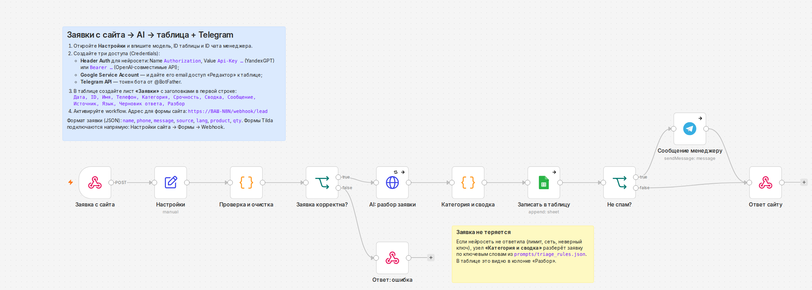

# Заявки с сайта → AI → Google Таблица + Telegram · n8n lead automation

🇷🇺 [Русский](#русский) · 🇬🇧 [English](#english)



---

## Русский

Каждая заявка с сайта сама попадает в таблицу и в Telegram менеджеру, уже разобранная нейросетью: что хочет клиент, насколько срочно, краткая сводка и готовый черновик ответа на языке клиента. Менеджер не читает «простыни», а сразу перезванивает тем, кто готов купить.

**Что происходит с заявкой**

1. **Приём.** Форма сайта (своя, Tilda, квиз) отправляет заявку на вебхук.
2. **Проверка.** Имя и телефон проверяются, номер приводится к виду `+7…`, боты отсеиваются скрытым полем.
3. **AI-разбор.** YandexGPT (или любая OpenAI-совместимая модель) определяет категорию — заказ, опт, вопрос, жалоба или спам — и срочность, пишет сводку для менеджера и черновик ответа клиенту на русском, арабском или английском.
4. **Таблица.** Строка в Google Таблице: дата, контакты, категория, сводка, черновик ответа.
5. **Telegram.** Сообщение менеджеру; спам в чат не попадает.
6. **Ответ сайту.** Форма сразу показывает «Спасибо».

**Надёжность:** если нейросеть недоступна (лимит, сеть, неверный ключ), заявка не теряется — её разберут правила по ключевым словам. Таблица и Telegram независимы: сбой одного не мешает другому.

Так выглядит сообщение менеджеру:

```
🟢 Заказ · срочно
👤 Анна · +79211234567
📝 Анна хочет 2 банки таёжного мёда, доставка на Васильевский
💬 Таёжное разнотравье × 2. Доставка на Васильевский
✍️ Черновик ответа: Анна, спасибо! Перезвоним через 15 минут.
🌐 landing-ru · ru · L-20261001-1314-8a2b
```

### Две версии одной схемы

| | n8n (`n8n/lead-triage.json`) | Python (`api/`) |
|---|---|---|
| Для кого | клиент хочет видеть и менять схему мышкой | нужен свой сервер без n8n или встройка в продукт |
| Запуск | импорт JSON в n8n (облако или свой сервер) | FastAPI + Docker |
| Хранилище | Google Таблица | Google Таблица или CSV |

Логика у версий одна: промпт (`prompts/triage_system.txt`) и правила (`prompts/triage_rules.json`) общие, а тесты прогоняют JavaScript из n8n и Python на одних и тех же заявках и сверяют результат.

### Запуск в n8n

1. Импортируйте `n8n/lead-triage.json` (меню ⋯ → Import from File) или через Docker:
   ```bash
   cp .env.example .env            # впишите N8N_ENCRYPTION_KEY
   docker compose up -d n8n
   docker compose exec n8n n8n import:workflow --input=/workflows/lead-triage.json
   ```
2. В узле **«Настройки»** впишите модель (`gpt://<folder_id>/yandexgpt/latest`), ID таблицы и ID чата менеджера.
3. Создайте три доступа (Credentials):
   - **Header Auth** — Name `Authorization`, Value `Api-Key <ключ>` для YandexGPT (ключ сервисного аккаунта с ролью `ai.languageModels.user`) или `Bearer <ключ>` для других OpenAI-совместимых API;
   - **Google Service Account** — и дайте email сервисного аккаунта доступ «Редактор» к таблице;
   - **Telegram API** — токен бота от @BotFather (бота нужно добавить в чат менеджера).
4. В таблице создайте лист **«Заявки»** с заголовками: `Дата, ID, Имя, Телефон, Категория, Срочность, Сводка, Сообщение, Источник, Язык, Черновик ответа, Разбор`.
5. Нажмите **Publish**. Адрес для формы: `https://<ваш-n8n>/webhook/lead`.

**Проверка:** `scripts/send_test_lead.sh https://<ваш-n8n>/webhook/lead` отправит три тестовые заявки (заказ и опт на русском, заказ на арабском).

### Подключение формы

- **Свой сайт:** `POST` JSON с полями `name`, `phone`, `message`, `source`, `lang`, `product`, `qty`. Готовый пример — лендинг [landing-ru-ar](https://github.com/AbdAllAh950/landing-ru-ar): адрес вебхука указывается в `assets/config.js`. CORS открыт, запросы с браузера проходят.
- **Tilda:** Настройки сайта → Формы → Webhook → адрес вебхука. Поля `Name`, `Phone`, `Comments` распознаются автоматически, а проверочный запрос Tilda получает ответ 200.

### Python-версия (без n8n)

```bash
cd api
python3 -m venv .venv && source .venv/bin/activate
pip install -r requirements.txt
cp ../.env.example .env        # ключи AI, Telegram; без GOOGLE_SHEET_ID заявки пишутся в data/leads.csv
uvicorn app.main:app --port 8000
```

Или `docker compose up -d api`. Эндпоинты: `POST /lead`, `GET /health`.

### Тесты

```bash
pip install -r api/requirements.txt
pytest -q
```

39 тестов. Они проверяют, что файл workflow собран из актуальных исходников, все связи узлов ведут на существующие узлы, в экспорте нет ключей, а JavaScript из n8n совпадает с Python: категории, сводки, черновики ответов, нормализация телефонов, проверка полей, поля Tilda. API проверяется целиком: AI-ответ в ```-блоке, падение AI → правила, спам без уведомления, honeypot, CORS, экранирование HTML в Telegram, заявка на арабском.

Кроме того, workflow запускался в n8n 2.41.5 с подменёнными AI и Telegram. Проверены заказ, опт при недоступной AI (повтор и правила), спам, неверный телефон (400), honeypot, заявка на арабском, preflight CORS, формат Tilda и отправка формы с лендинга из браузера.

### Под заказ

Подключение к вашему сайту, Tilda или квизу; amoCRM или Bitrix24 вместо таблицы; уведомления в MAX; автоответ клиенту в Telegram или WhatsApp; отчёт по заявкам за неделю.

### Структура

```
n8n/lead-triage.json        workflow для импорта в n8n (собирается скриптом)
n8n/code/*.js               код узлов «Проверка и очистка» и «Категория и сводка»
prompts/                    промпт для AI и правила — общие для n8n и Python
scripts/build_workflow.py   собирает n8n/lead-triage.json из исходников
scripts/send_test_lead.sh   тестовые заявки
api/                        FastAPI-версия + Dockerfile + тесты
tests/                      проверки workflow и сверка JS ↔ Python
docker-compose.yml          n8n + API
```

---

## English

Every website lead lands in a Google Sheet and in the manager's Telegram, already sorted by an LLM: category (order, wholesale, question, complaint, spam), urgency, a one-line summary for the manager, and a draft reply in the customer's language (Russian, Arabic or English). If the AI is down, keyword rules take over, so no lead is lost. Spam is logged but never pings the manager.

**Two implementations of one pipeline:** an n8n workflow (`n8n/lead-triage.json`, for clients who want to see and edit the flow visually) and a FastAPI service (`api/`). Both share the prompt and the fallback rules (`prompts/`). The test suite runs the n8n Code-node JavaScript and the Python code on the same inputs and checks they agree. Works with YandexGPT through its OpenAI-compatible endpoint (usable from Russia without a VPN) or any OpenAI-compatible API. Accepts JSON from custom forms and Tilda's form-encoded webhooks, including Tilda's `test=test` ping, and allows CORS.

**Verified** with 39 automated tests, plus live runs in n8n 2.41.5 against mocked LLM and Telegram APIs: order, wholesale with the AI down (retry, then rules), spam, invalid phone, honeypot, an Arabic lead, CORS preflight, the Tilda format, and a browser form submission from the [landing page](https://github.com/AbdAllAh950/landing-ru-ar).

**Run:** import the JSON into n8n and fill in **Настройки** plus three credentials (Header Auth, Google Service Account, Telegram), or `docker compose up -d`. Tests: `pytest -q`.

---

Автор / Author: Abdallah Essa · MSc Big Data & ML, ITMO · [GitHub](https://github.com/AbdAllAh950)
